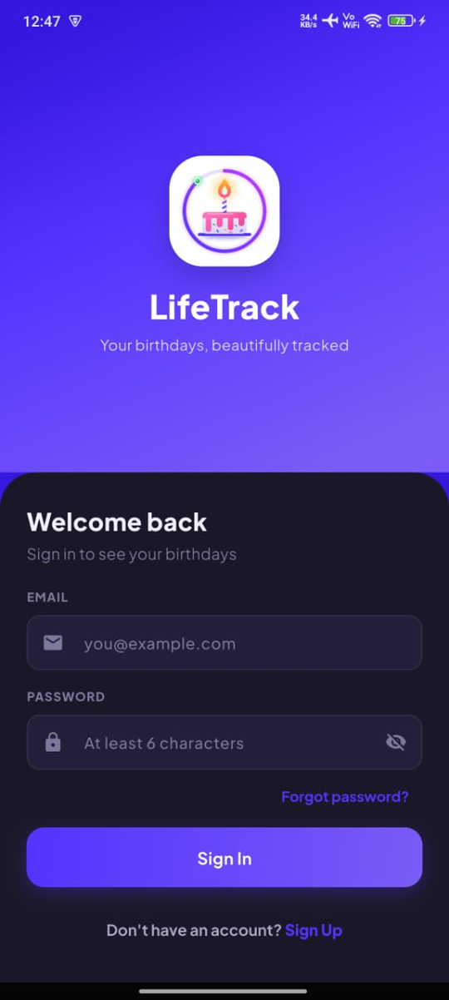
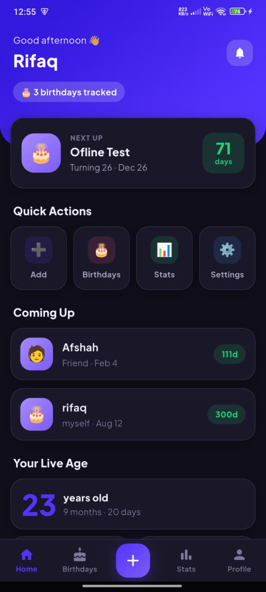
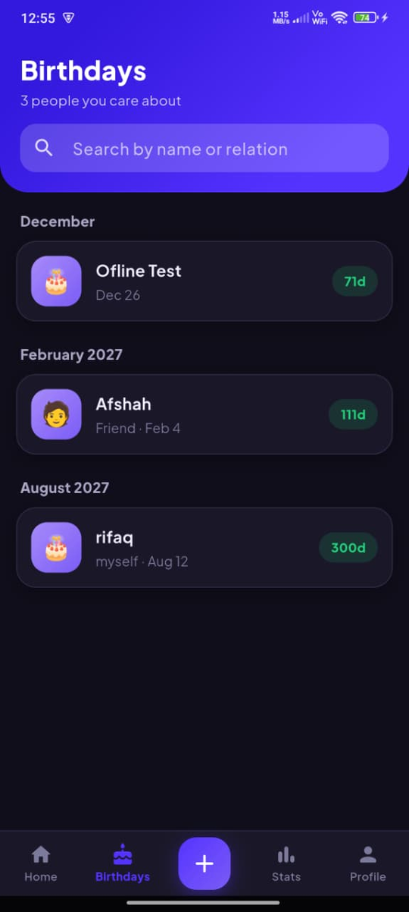
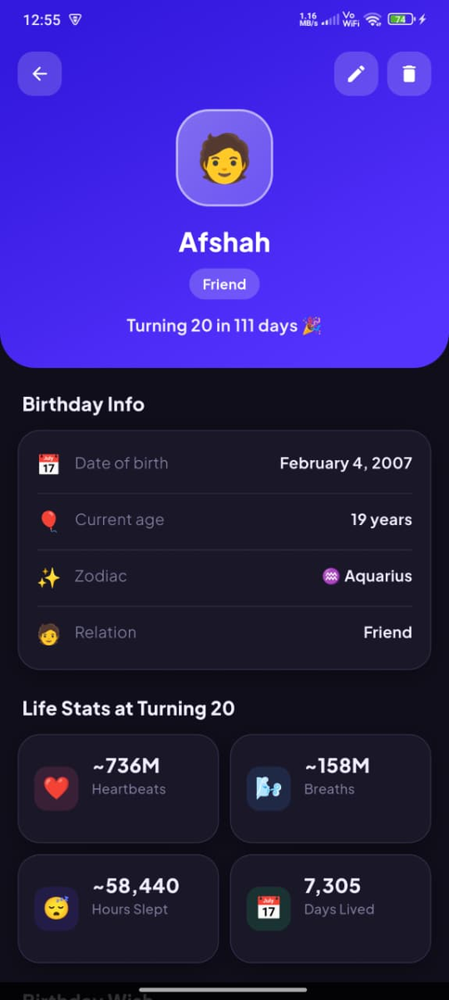
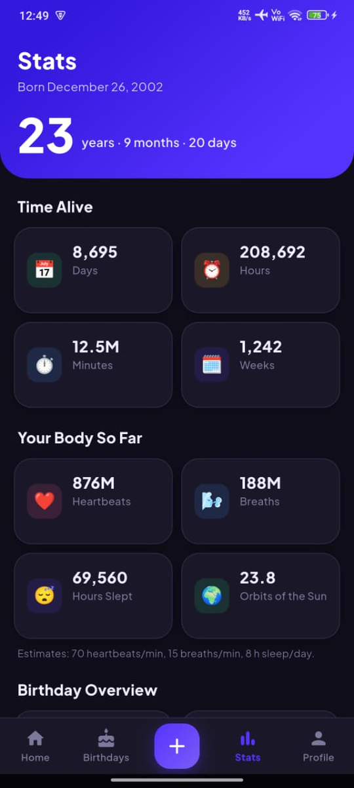
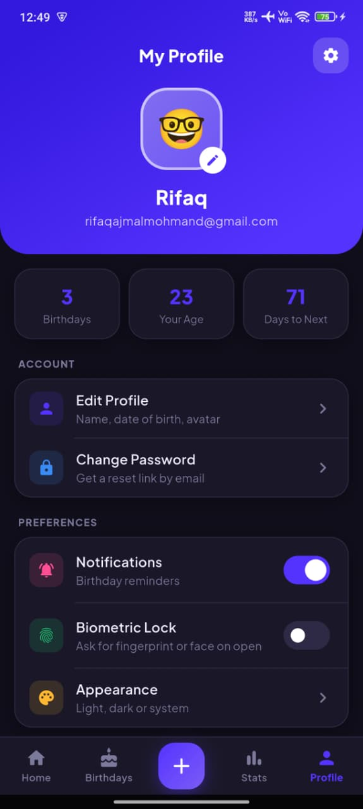

# 🎂 LifeTrack

**Never miss a birthday again.** Track birthdays, see live age stats, and celebrate the moments that matter — with a beautiful, privacy-friendly Flutter app.


---

## ✨ Features

| Feature | Description |
|---|---|
| 🔐 **Authentication** | Email/password sign-up (with your name) and login via Firebase Auth, password reset by email |
| 🎂 **Birthday tracking** | Add, edit and delete birthdays with name, relation, emoji avatar, date and an optional note |
| ⏱️ **Live age** | Your own age in years, months and days, plus days, hours and minutes lived |
| ☁️ **Cloud sync** | Birthdays sync in real time via Firebase Realtime Database, and can be added offline |
| 📴 **Offline support** | Birthdays are cached locally with Hive so the list opens without a connection |
| 🔔 **Smart reminders** | On the day, 1 day and 1 week before at 9:00, plus optional "every 1,000 days lived" alerts |
| ⭐ **Zodiac signs** | Calculated from the date of birth |
| 📊 **Life Stats** | Estimated heartbeats, breaths and hours slept, also "at turning N" for each birthday |
| 💌 **Wish generator** | Generate, regenerate, copy and share a birthday wish |
| 🖼️ **Share as image** | Export a branded birthday card image |
| 👤 **Profile page** | Separate account page: edit name, date of birth and avatar, change password, log out |
| 🌗 **Dark mode** | Light, dark or system theme |
| 🔒 **Biometric app lock** | Optional fingerprint / face / screen-lock check on open |
| 🔍 **Search** | Search by name or relation; birthdays grouped by Today, Upcoming and month |

## 🌱 Project Journey

LifeTrack grew with me through my BS Computer Science degree at UET Mardan:

1. **Semester 1:** it began as a simple **age calculator**, my first real project.
2. **Semester 6 (Mobile Application Development):** I extended it into a full **birthday reminder app** with Firebase, notifications and Life Stats. That version is kept in my [BSCS-Journey](https://github.com/Rifaqajmal/BSCS-Journey/tree/main/Semester-6/MAD/Semester-Project/life_track) repository.
3. **Now:** this repository is the complete, polished version, with a redesigned interface, a separate profile page, offline support, dark mode, biometric lock, custom branding and Play Store preparation.

## 📱 Screenshots

<p align="center">
  
  
  
</p>
<p align="center">
  
  
  
</p>

## 🛠️ Tech Stack

- **Framework:** Flutter 3.x / Dart 3.x
- **State management:** Provider
- **Backend:** Firebase Authentication, Firebase Realtime Database
- **Offline storage:** Hive
- **Notifications:** flutter_local_notifications + timezone
- **Biometrics:** local_auth
- **Sharing:** share_plus, screenshot
- **Architecture:** Feature-organized folders (`core/`, `screens/`, `widgets/`, `services/`, `providers/`, `models/`)

## 📂 Project Structure

```
lib/
├── core/
│   ├── constants/     # Colors (design tokens), strings, theme
│   └── utils/         # Dates, age, life stats, reminders schedule, formatting
├── models/             # BirthdayModel, AppUserModel
├── providers/          # Birthday, User, Profile, Settings, Theme
├── screens/
│   ├── auth/           # Login / sign-up, auth state routing
│   ├── shell/          # Bottom navigation (Home, Birthdays, Stats, Profile)
│   ├── home/           # Dashboard
│   ├── birthday/       # List, detail, add/edit
│   ├── stats/          # Live age and totals
│   ├── profile/        # Account page and edit profile
│   ├── settings/       # Appearance, notifications, security, privacy policy
│   └── splash/         # Startup + biometric gate
├── services/           # Firebase, Hive, notifications, biometrics, sharing
└── widgets/            # Reusable UI components
```

## 🚀 Getting Started

### Prerequisites
- Flutter SDK (3.x or newer) — [install guide](https://docs.flutter.dev/get-started/install)
- A Firebase project with **Authentication** (Email/Password) and **Realtime Database** enabled

### Setup

1. **Clone the repo**
   ```bash
   git clone https://github.com/<your-username>/lifetrack.git
   cd lifetrack
   ```

2. **Install dependencies**
   ```bash
   flutter pub get
   ```

3. **Add your Firebase config**

   This repo does **not** include `google-services.json` / `GoogleService-Info.plist` (they're gitignored, since they're project-specific).

   - Create a Firebase project at [console.firebase.google.com](https://console.firebase.google.com)
   - Add an Android app with package name `com.rifaqajmal.lifetrack` (or your own, matching `android/app/build.gradle.kts`)
   - Download `google-services.json` → place it at `android/app/google-services.json`
   - (iOS) Add an iOS app, download `GoogleService-Info.plist` → place it at `ios/Runner/GoogleService-Info.plist`
   - Enable **Email/Password** sign-in under Authentication → Sign-in method
   - Enable **Realtime Database** and set rules appropriate for your use case

4. **Generate app icon & splash screen assets** (source artwork is included under `assets/icon/`)
   ```bash
   flutter pub run flutter_launcher_icons
   flutter pub run flutter_native_splash:create
   ```

5. **Run the app**
   ```bash
   flutter run
   ```

### Building a release

See [`android/key.properties.example`](android/key.properties.example) for release-signing setup before building a release APK/AAB.

```bash
flutter build apk --release
# or
flutter build appbundle --release
```

## 📄 Additional Documentation

- [Privacy Policy](docs/PRIVACY_POLICY.md)
- [Play Store Data Safety reference](docs/PLAY_STORE_DATA_SAFETY.md)
- [Play Store listing draft](docs/PLAY_STORE_LISTING.md)

## 👤 Author

**Rifaq Ajmal**
BS Computer Science, UET Mardan

## 📝 License

All Rights Reserved — see [LICENSE](LICENSE). This code is public for portfolio purposes only; see the license file for what that does and doesn't permit.
