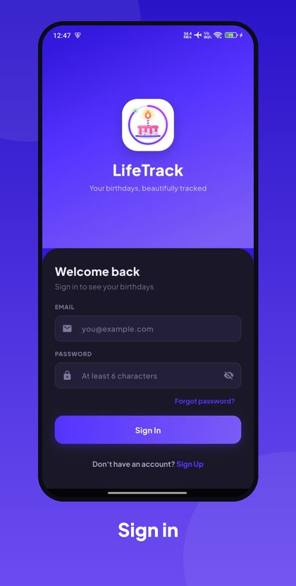
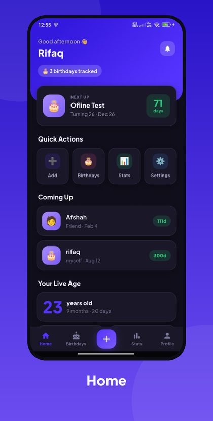
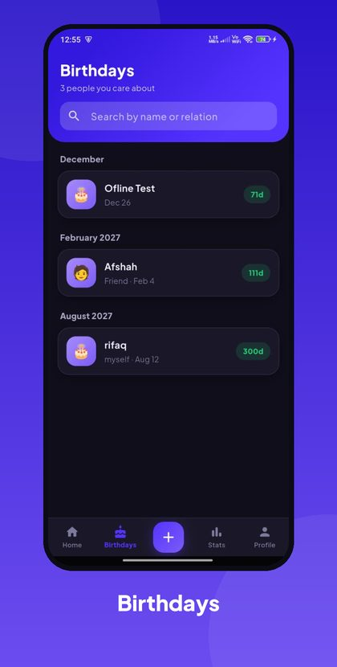
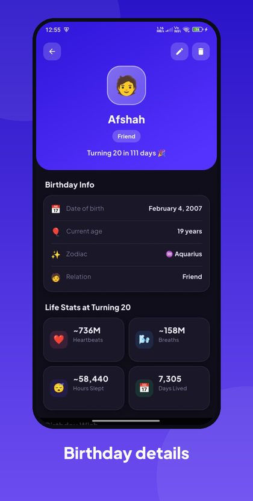
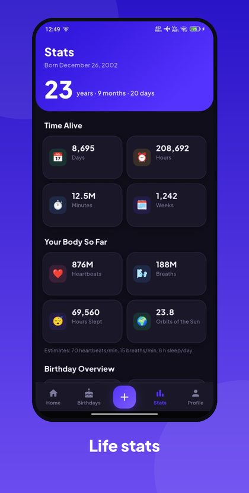
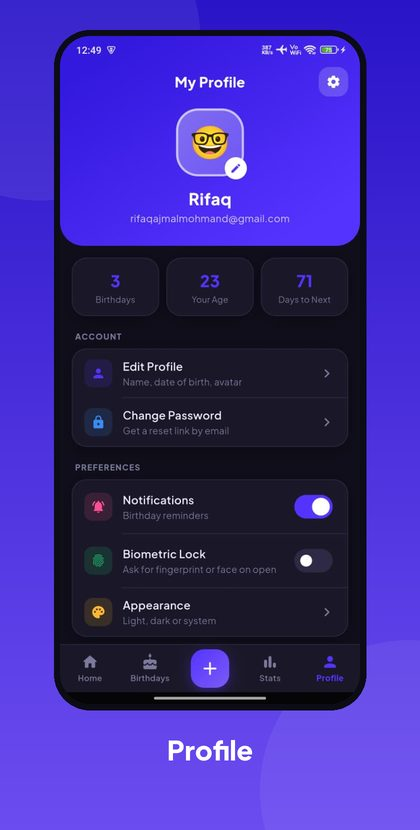

# 🎂 LifeTrack

**Never miss a birthday again.** Track birthdays, watch your own age tick live, and get reminded in time, all in a fast, privacy-friendly Flutter app.


<table>
  <tr>
    <td align="center"></td>
    <td align="center"></td>
    <td align="center"></td>
  </tr>
  <tr>
    <td align="center"></td>
    <td align="center"></td>
    <td align="center"></td>
  </tr>
</table>

## ✨ Features

- 🔔 **Smart reminders** at 9:00 on the birthday, 1 day before and 1 week before, plus optional "every 1,000 days lived" alerts. They arrive even when the app is closed.
- 🎂 **Birthday tracking** with name, relation, emoji avatar, date and a note. Search, and see Today / Upcoming / by month.
- ⏱️ **Live age** in years, months and days, with days, hours, minutes, heartbeats and breaths lived.
- ⭐ **Zodiac sign** and **life stats at turning N** for every birthday.
- 💌 **Wish generator** and **share as a branded image card**.
- ☁️ **Cloud sync** with Firebase, plus **offline mode**: add birthdays without internet and they sync later.
- 👤 **Profile page** to edit your name, date of birth and avatar, change your password, and log out.
- 🔒 **Biometric app lock**, verified both to turn on and to turn off.
- 🔑 **Password manager support** (Android autofill) and password reset by email.
- 🌗 **Light, dark or system theme**, with a custom logo and launch screen.

## 🌱 Project Journey

LifeTrack grew with me through my BS Computer Science degree at UET Mardan:

1. **Semester 1:** a simple **age calculator**, my first real project.
2. **Semester 6 (Mobile Application Development):** extended into a full **birthday reminder app**. That version lives in my [BSCS-Journey](https://github.com/Rifaqajmal/BSCS-Journey/tree/main/Semester-6/MAD/Semester-Project/life_track) repository.
3. **Now:** this repository, the complete polished version with a redesigned interface, profile page, offline support, dark mode, biometric lock, custom branding and Play Store preparation.

## 🛠️ Tech Stack

| Area | Tools |
|---|---|
| Framework | Flutter, Dart |
| State management | Provider |
| Backend | Firebase Authentication, Firebase Realtime Database |
| Offline storage | Hive, SharedPreferences |
| Notifications | flutter_local_notifications, timezone |
| Security | local_auth (biometrics) |
| Sharing | share_plus, screenshot |

## 📂 Project Structure

```
lib/
├── core/        # design tokens, theme, strings, date/age/reminder utilities
├── models/      # BirthdayModel, AppUserModel
├── providers/   # Birthday, User, Profile, Settings, Theme
├── screens/     # auth, shell, home, birthday, stats, profile, settings, splash
├── services/    # Firebase, Hive, notifications, biometrics, sharing
└── widgets/     # reusable UI components
```

## 🚀 Getting Started

**Prerequisites:** [Flutter SDK](https://docs.flutter.dev/get-started/install) 3.32 or newer, and a Firebase project with **Authentication (Email/Password)** and **Realtime Database** enabled.

1. **Clone and install**
   ```bash
   git clone https://github.com/Rifaqajmal/LifeTrack-Updated.git
   cd LifeTrack-Updated
   flutter pub get
   ```

2. **Add your Firebase config.** `google-services.json` is not in this repo (it is gitignored).
   - Create a project at [console.firebase.google.com](https://console.firebase.google.com)
   - Add an Android app with package name `com.rifaqajmal.lifetrack` (or your own, matching `android/app/build.gradle.kts`)
   - Download `google-services.json` and place it at `android/app/google-services.json`
   - Enable Email/Password sign-in and create a Realtime Database
   - *(iOS)* add an iOS app and place `GoogleService-Info.plist` in `ios/Runner/`

3. **Run**
   ```bash
   flutter run
   ```

App icons and the launch screen are already included, so there is nothing to generate.

**Release build:** set up signing with [`android/key.properties.example`](android/key.properties.example), then run `flutter build appbundle --release`.

## 📄 More Documentation

[Privacy Policy](docs/PRIVACY_POLICY.md) · [Play Store Data Safety](docs/PLAY_STORE_DATA_SAFETY.md) · [Play Store listing draft](docs/PLAY_STORE_LISTING.md)

## 👤 Author

**Rifaq Ajmal**, BS Computer Science, UET Mardan

## 📝 License

All Rights Reserved. See [LICENSE](LICENSE). This code is public for portfolio purposes only.
